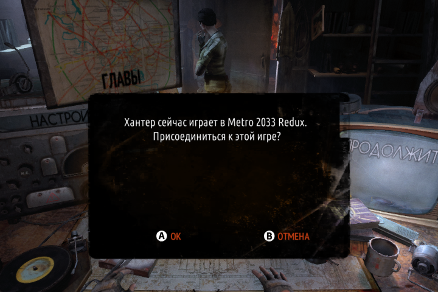
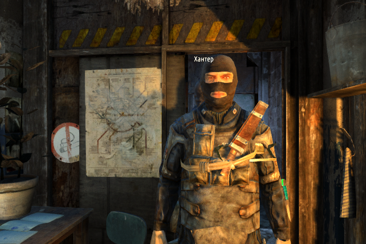
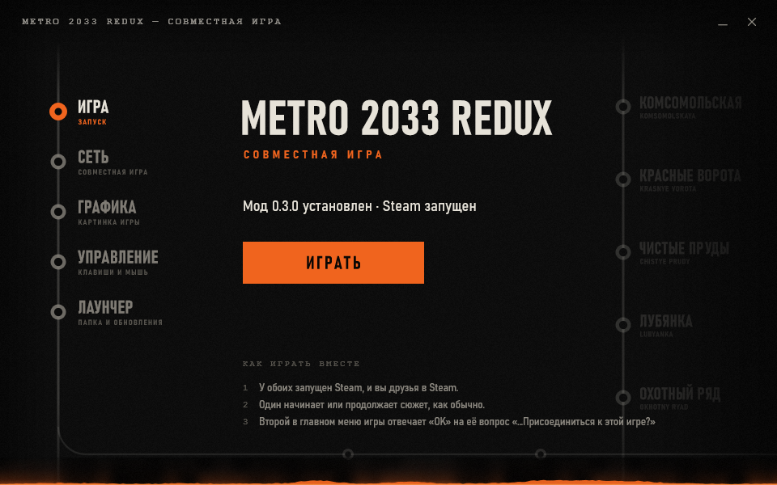

<h1 align="center">Metro 2033 Redux — the story together</h1>

<p align="center">
  <b>metronet — network co-op for the story of Metro 2033 Redux (PC, GOG)</b><br>
  Everyone has their own copy of the game and their own screen · join a friend through Steam, no addresses or ports · nothing to set up
</p>

<p align="center">
  
  
  
  
  
  
</p>

<p align="center">
  <a href="README.md">Русский</a> · <b>English</b>
</p>

<p align="center">
  
</p>

**metronet** is a mod for the GOG version of *Metro 2033 Redux*. The game still holds the 4A engine's own network
mode, left there from its development. The mod turns it on for the story and repairs what breaks in it: one player
leads their game as usual, the others come in and get characters of their own. Levels, scenes, doors, handcars,
enemies and shooting are shared.

> The mod holds no files of the game and does not change `metro.exe` on the disk: everything is done in memory
> when the game starts. You need your own copy of the game. This is an unofficial fan mod; **the build is a
> trial one** — see [project status](#project-status).

**Other mods of this series:**
[TMNT (2003)](https://github.com/int3re/TMNT-2003-COOP) ·
[TMNT 2: Battle Nexus](https://github.com/int3re/TMNT-2-BATTLE-NEXUS-COOP) ·
[TMNT Mutant Melee](https://github.com/int3re/TMNT-MUTANT-MELEE-COOP) ·
[The Incredibles: Rise of the Underminer](https://github.com/int3re/INCREDIBLES-RISE-OF-THE-UNDERMINER-COOP)

## Contents

- [How to play together](#how-to-play-together)
- [The launcher](#the-launcher)
- [What the mod does](#what-the-mod-does)
- [Project status](#project-status)
- [What you need](#what-you-need)
- [Building from source](#building-from-source)
- [How it works](#how-it-works)
- [Taking part](#taking-part)
- [Thanks](#thanks)
- [Thank the author](#thank-the-author)
- [Licence and rights](#licence-and-rights)

## How to play together

There is nothing to set up and no file to edit. Both players need Steam running and must be Steam friends
(nothing has to be bought: the game runs as Valve's free application "Spacewar").

1. **One of you** starts the game and begins or continues the story as usual. Until somebody comes in, it is a
   plain single-player game.
2. **The other** starts the game and gets to the main menu. The game asks in its own window: "<friend's name> is
   playing Metro 2033 Redux now. Join this game?" — answer "OK".
3. The game loads the friend's level, and a couple of seconds later the joined player has a character of their
   own next to the friend.

To leave, use "Exit to the main menu" of the pause menu; you can come back at any moment. When the leading player
ends the game, the others' games return to their main menus by themselves. Progress is saved by the leading
player into their usual save; a joined game saves nothing and does not touch its own progress.

The fallback — play by IP address (one network, a VPN, or UDP port 1000 forwarded) — is described in
[dist/README.md](dist/README.md) (Russian).

<p align="center">
  
</p>

## The launcher

`metronet-launcher.exe` is one file with the mod inside: it finds the game, installs and updates the mod, starts
the game and shows whether Steam is running. It also holds the settings: network play (names over heads, friendly
fire, play by IP) and the game's own graphics and controls (resolution, quality, field of view, keys, mouse — the
launcher changes the lines of the game's `user.cfg` that are needed and keeps a copy before its first change). Its
look is its own, after the game's interface; it holds no files or art of the game.

<p align="center">
  
</p>

Download: [`metronet-launcher.exe` of the latest release](../../releases/latest) - run it, pick the game folder if
the launcher did not find it, and press INSTALL. From then on the launcher asks GitHub at every start: a newer
launcher takes the old one's place and a newer mod is installed without a question (this can be turned off on the
LAUNCHER station). Building the mod from source - below.

## What the mod does

- **Joining with no setup.** Whoever plays the story is visible to their Steam friends; the level becomes a
  network game at the moment a friend comes in. The question "Join?" is asked by the game's own window.
- **A character for everyone.** A joined player gets a body — a copy of Artyom — with all of the leading player's
  gear: three guns, ammunition, grenades, medkits. They shoot, reload and change weapons themselves.
- **A shared world.** A joined player's bullets hurt and kill enemies; the level's scripts act on everyone; doors,
  levers, wheels, cabinets and talks that one player "used" happen on every PC; the handcar runs the same, the
  joined player stands beside the leading one on it, and takes the next seat in the car or on any other vehicle;
  doors, gates and whatever moves in the level move for the joined players as for the leading one (a door a story
  character opens too); crates, barrels and other loose things one player's physics moved lie the same for all.
- **The story for all, the personal for oneself.** A zone of the level's script starts its scene for everybody
  when anybody walks in, while what the zone does to the player (the weapon lowered at a station, the gas mask and
  its filters, fire, a lift) happens only to the player who walked in. When a scene hides the leading player's
  weapon, the joined player puts theirs away too.
- **Each player's own loot.** Everyone picks up for themselves: what one player took - ammunition, medkits,
  filters, a weapon from a stash - stays in place for the others until they take it. An enemy's weapon is one for
  all: who takes it first has it.
- **Level changes.** The leading player changes levels, the others follow by themselves and get new bodies.
- **Wounded, not killed.** A player who would die falls badly wounded: crouches low, cannot walk or shoot and
  waits for a teammate, who holds Use next to them for three seconds to raise them; both see a caption and a bar of
  how far the raise has come. When everybody is down, the last checkpoint
  is loaded for everybody.
- **Players' names** — their Steam names — over their heads and in lines like "… is joining the game", in the
  game's own font.
- **Repaired faults of the game itself** that stood in the way of network play: a freeze in a long fight (a
  deadlock of threads on the collision tree), a crash of the joined game when the leading one removes a monster
  in the middle of a fight, the disconnection of a player whose level loads slowly.

The full list with the known faults is in [dist/README.md](dist/README.md) (Russian).

## Project status

**The first real game** (0.3.0, two people on two PCs through real Steam): the friend joined the host from the
main menu and the session ran. What it found is fixed in 0.3.1: cabinets and gate wheels did not open for the
second player, after the host left the friend's game stood on a blurred picture, the host's death menu paused the
game (0.3.1); a door a story character opened stayed shut for the friend, loot went to one player only, and a
joined player got nothing they picked up (0.4.0).

The build is an early one, and it has been tested only automatically: two and three copies of the game on one PC,
driven by a script, with pictures of the frames each game draws.

**Tested that way:** a second player joining at the start of each of the 27 story levels; in detail — "Hunter",
"Exhibition", "Chase", "Defence": own body, walking, shooting, level change, death and respawn, the handcar, the
leading player loading a checkpoint, leaving and coming back, three players.

**Not tested:**

- 0.3.1 and 0.4.0 in a real game: their fixes are tested automatically, not by people yet. The lab tests a joined
  player's take with the "take" event its copy sends, not with a button (its window is never the active one); an
  enemy's weapon taken by one player was not tested in the lab;
- keyboard and mouse play in a session (the tests drive the game with a scripted gamepad);
- two real PCs over a real network;
- playing levels beyond their first minutes;
- more than three players (the engine has room for 32).

**0.4.1 was built on request without testing:** the downed player crouching with a raise bar, other players'
first-person hands, weapons in scenes, the seat on any vehicle, loose physics things, zones "the story for all,
the personal for oneself", closing the game during the menu's intro video, joining beside a leader who has not
walked yet. Each part has a switch in `metronet.ini` (see [dist/README.md](dist/README.md)).

**Not sent between the players yet:** what story characters far from the leading player do and say when only the
leader's script started their scene.

**Not there yet:** an item of its own in the main menu (in Redux that menu is a 3D scene — labels on the things
of a desk); the mod asks through the game's window once a friend is playing.

Only the GOG build of `metro.exe` from September 2014 fits. With another build the mod touches nothing and says
so in `metronet.log`.

## What you need

- Windows 10 or 11, 64-bit.
- *Metro 2033 Redux*, the GOG version — a copy of their own for every player.
- Steam running on every PC, and Steam friendship — for play through Steam. Play by IP needs no Steam.
- The same version of the mod on every PC.

## Building from source

You need Visual Studio 2022 or newer (the C++ compiler and CMake).

```
cmake -S . -B build -A x64
cmake --build build --config Release
```

`build/dist/Release` then holds `dinput8.dll`, `metronet.asi`, `metronet.ini`, `metronet-README.md` and the
launcher. Play through Steam needs the Steamworks SDK (not part of the repository): give its folder with
`-DSTEAMWORKS_SDK_DIR=<path>/sdk` and `metronet_steam_api64.dll` appears beside them. Without the SDK the mod
builds with play by IP address only.

## How it works

- `dinput8.dll` is a small loader: the game imports `DirectInput8Create` itself, the loader loads `metronet.asi`
  and hands the calls on to the real library.
- `metronet.asi` is the mod. It turns the loaded level into a server of the engine's own network mode, gives the
  joined players bodies (copies of the player, made by the engine's own means), and carries what the old network
  code does not send — handcars, doors, script zones, the state of characters — over a message channel of its own
  inside the same connection.
- **Steam.** The game's network code talks UDP through the ENet library built into it. The mod catches its two
  socket calls: every Steam user has a made-up address, and packets to such an address leave as Steam messages
  (through Valve's relays). Real addresses go as before. The leading player's game keeps a friends-only lobby.
- **The screen.** The names, the lines and the question "Join?" are drawn by the game itself: its fonts, its
  text conversion and its own confirmation window.
- **The lab** (`tools/lab`) — automatic runs of several copies of the game with no window on the screen, a
  scripted gamepad and a stand-in for Steam. It needs your own copy of the game and your own saves.

## Taking part

Bug reports and proposals go to [Issues](../../issues). Attach `metronet.log` from the game folder **from every
PC** and say on which level what happened. Look the log through before you publish it: it holds your Steam name
and the game's folder.

How to propose a change: [CONTRIBUTING.en.md](CONTRIBUTING.en.md).

## Thanks

| To | For | Licence |
|---|---|---|
| [MetroDeveloper](https://github.com/tsnest/MetroDeveloper) (tsnest) | scouting the engine's network code, the player-slot fix | MIT |
| [metro2033redux-coop](https://github.com/realblastex/metro2033redux-coop) (realblastex) | the prototype: a level as a server, linking the player to its slot | MIT |
| [MinHook](https://github.com/TsudaKageyu/minhook) (Tsuda Kageyu) | x64 function hooks | BSD 2-Clause |
| [Steamworks SDK](https://partner.steamgames.com/) (Valve) | the network through Steam; not part of the repository | Valve's licence |
| [Ghidra](https://ghidra-sre.org/) and [Capstone](https://www.capstone-engine.org/) | the tools the game was taken apart with | Apache 2.0, BSD |
| [coop-anything](https://github.com/cranebeaker/coop-anything) | ways of turning a single-player game into a network one and of testing it | — |
| [rea](https://github.com/morluto/rea) | tools for taking executables apart | — |
| The series' mods: [TMNT 2003](https://github.com/int3re/TMNT-2003-COOP), [TMNT 2](https://github.com/int3re/TMNT-2-BATTLE-NEXUS-COOP), [Mutant Melee](https://github.com/int3re/TMNT-MUTANT-MELEE-COOP), [The Incredibles](https://github.com/int3re/INCREDIBLES-RISE-OF-THE-UNDERMINER-COOP) | play through Steam, the lab and the launcher's base grew out of them | MIT |

Special thanks to **4A Games** for the game and for the engine that still holds a network mode.

## Thank the author

The mod is free. If it was of use to you and you want to say thank you, you can send **USDT** to one of these
addresses:

| Network | Wallet address (USDT) |
|---|---|
| **TRON (TRC20)** | `TVdy7i7qoF1ZdrnNSZaC5Mgz1ZddaMhw4y` |
| **The Open Network (TON)** | `UQB-oxQVLLN3hm-YRGfr5-XJ95P0zIAeLFstgG40HiaR8oMz` |
| **BNB Smart Chain (BEP20)** | `0xA11f8221952FA5f540bC528072213b14F124379B` |

- The smallest amount is **0.1 USDT**.
- Send only USDT and only over the network whose address you chose: another coin or another network will not
  arrive.
- The USDT contract on BNB Smart Chain:
  [`0x55d398326f99059fF775485246999027B3197955`](https://bscscan.com/token/0x55d398326f99059fF775485246999027B3197955).

You can say thank you without money too: a star for the repository, a bug report, or a log after a game.

## Licence and rights

The mod's code is distributed under the [MIT](LICENSE) licence. MinHook keeps its BSD 2-Clause licence
([third_party/minhook/LICENSE.txt](third_party/minhook/LICENSE.txt)). The game, its files and its art are not
covered by the mod's licence.

This is an unofficial fan project. It is not connected with 4A Games, Deep Silver, Dmitry Glukhovsky or other
rights holders and is not endorsed by them. *Metro 2033* and related names are trademarks of their owners. The
repository holds no files of the game: the mod needs your own copy. The screenshots show the mod at work and are
given for illustration; the players' names in them are made up. The launcher's look is its own: it holds no
logos or art of the game.

For play through Steam the mod uses the identifier of Valve's test application Spacewar (AppID 480), so Steam
shows the status "Spacewar" while you play.
