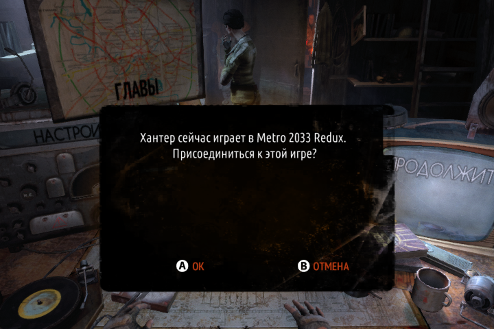
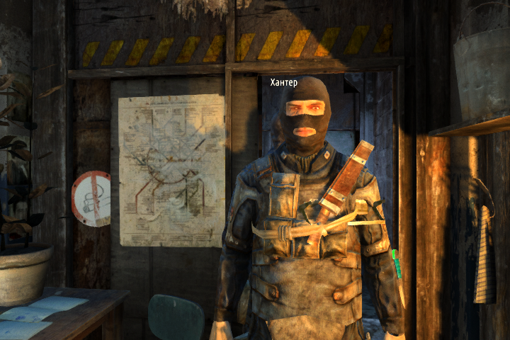
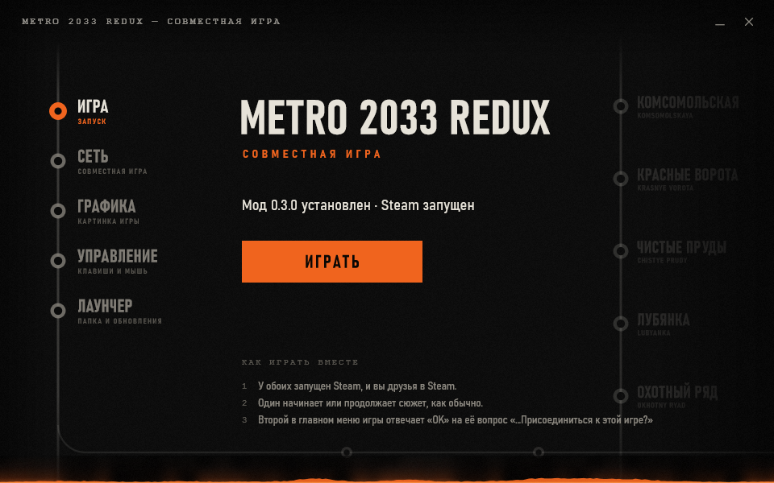

<h1 align="center">Metro 2033 Redux — сюжет вместе</h1>

<p align="center">
  <b>metronet — сетевой кооператив для сюжета Metro 2033 Redux (ПК, GOG)</b><br>
  У каждого своя копия игры и свой экран · вход к другу через Steam без адресов и портов · ничего не нужно настраивать
</p>

<p align="center">
  
  
  
  
  
  
</p>

<p align="center">
  <b>Русский</b> · <a href="README.en.md">English</a>
</p>

<p align="center">
  
</p>

**metronet** — мод для GOG-версии *Metro 2033 Redux*. В игре со времён разработки остался собственный сетевой
режим движка 4A. Мод включает его для сюжета и чинит то, что в нём ломается: один игрок ведёт свою игру как
обычно, остальные входят к нему и получают собственных персонажей. Уровни, сцены, двери, дрезины, враги и
стрельба — общие.

> Мод не содержит файлов игры и не меняет `metro.exe` на диске: всё делается в памяти при запуске. Нужна своя
> копия игры. Это неофициальный фанатский мод; **сборка пробная** — см. [состояние проекта](#состояние-проекта).

**Другие моды этой серии:**
[TMNT (2003)](https://github.com/int3re/TMNT-2003-COOP) ·
[TMNT 2: Battle Nexus](https://github.com/int3re/TMNT-2-BATTLE-NEXUS-COOP) ·
[TMNT Mutant Melee](https://github.com/int3re/TMNT-MUTANT-MELEE-COOP) ·
[Суперсемейка: Подземная битва](https://github.com/int3re/INCREDIBLES-RISE-OF-THE-UNDERMINER-COOP)

## Содержание

- [Как играть вместе](#как-играть-вместе)
- [Лаунчер](#лаунчер)
- [Что умеет мод](#что-умеет-мод)
- [Состояние проекта](#состояние-проекта)
- [Что нужно для игры](#что-нужно-для-игры)
- [Сборка из исходников](#сборка-из-исходников)
- [Как это работает](#как-это-работает)
- [Участие](#участие)
- [Благодарности](#благодарности)
- [Поблагодарить автора](#поблагодарить-автора)
- [Лицензия и права](#лицензия-и-права)

## Как играть вместе

Настраивать ничего не нужно, файлы править не нужно. У обоих должен быть запущен Steam, и вы должны быть друзьями
в Steam (покупать ничего не надо: игра идёт под видом бесплатного приложения Valve «Spacewar»).

1. **Один из вас** запускает игру и начинает или продолжает сюжет как обычно. Пока никто не вошёл, это обычная
   одиночная игра.
2. **Второй** запускает игру и доходит до главного меню. Игра сама спрашивает своим окном: «<ник друга> сейчас
   играет в Metro 2033 Redux. Присоединиться к этой игре?» — ответьте «OK».
3. Игра загружает уровень друга, и через пару секунд у вошедшего появляется свой персонаж рядом с ним.

Выйти — «Выйти в главное меню» в паузе; войти снова можно в любой момент. Если ведущий закончил игру, игры
остальных сами возвращаются в главное меню. Прогресс сохраняется у ведущего в его обычное сохранение; игра
вошедшего ничего не сохраняет и своего прогресса не трогает.

Запасной способ — по IP-адресу (одна сеть, VPN или проброс порта UDP 1000) — описан в
[dist/README.md](dist/README.md).

<p align="center">
  
</p>

## Лаунчер

`metronet-launcher.exe` — один файл с модом внутри: находит игру, ставит и обновляет мод, запускает игру,
показывает, запущен ли Steam. В нём же настройки: сетевая игра (имена над головами, огонь по своим, игра по IP),
графика и управление самой игры (разрешение, качество, угол обзора, клавиши, мышь — лаунчер меняет нужные строки
её `user.cfg` и перед первой правкой оставляет копию). Оформление собственное, по мотивам интерфейса игры; её файлов
и графики в нём нет.

<p align="center">
  
</p>

Скачать: [`metronet-launcher.exe` из последнего выпуска](../../releases/latest) — запустить, выбрать папку игры,
если лаунчер не нашёл её сам, и нажать «УСТАНОВИТЬ». Дальше лаунчер при каждом запуске сам проверяет GitHub: новый
лаунчер встаёт на место старого, новая версия мода ставится без вопросов (это можно выключить на станции
«ЛАУНЧЕР»). Собрать мод из исходников — ниже.

## Что умеет мод

- **Вход без настроек.** Кто играет сюжет — того видят друзья в Steam; уровень становится сетевой игрой в момент,
  когда друг входит. Вопрос «Присоединиться?» задаёт окно самой игры.
- **«Сетевая игра» в главном меню.** На столе главного меню — надпись «СЕТЕВАЯ ИГРА» (клик мышью, клавиша N или
  кнопка Y геймпада): страница-блокнот самой игры со списком друзей Steam, которые играют сейчас (ник и глава),
  «Войти» — в игру выбранного, «Обновить», «Назад». Список обновляется сам.
- **Свой персонаж у каждого.** Вошедший получает тело — копию Артёма — со всем снаряжением ведущего: три ствола,
  патроны, гранаты, аптечки. Он стреляет, перезаряжается и меняет оружие сам.
- **Общий мир.** Пули вошедшего ранят и убивают врагов; сценарии уровня действуют на всех; двери, рычаги, вентили,
  шкафчики и разговоры, которые «использовал» один, срабатывают у каждого; двери, ворота и всё, что на уровне
  движется, у вошедших движется так же, как у ведущего (и дверь, которую открыл сюжетный персонаж); дрезина едет
  одинаково, вошедший стоит рядом с ведущим на ней, а в машине и на любом другом транспорте — на соседнем месте;
  ящики, бочки и прочие предметы, которые сдвинула физика у одного, лежат так же у всех.
- **Меню и «использовать».** Esc в сессии открывает обычное меню паузы, игра у остальных при этом идёт дальше.
  Сцену «использовать» (вентиль, рычаг) проходит только тот, кто нажал, остальные видят, как предмет движется.
  Сюжет ведущего узнаёт и об «использовать» второго игрока, но камеру и тело ведущего это не трогает.
  Вентиль крутит один игрок, остальные в это время его не возьмут; затвор, который он поднимает, у всех
  поднимается так же, а когда докручено — сюжет идёт дальше у всех. «Загрузить контрольную точку» работает и у
  второго игрока: загружает хост, для всех.
  Print Screen кладёт кадр игры в буфер обмена; в лаунчере есть режимы «В окне», «Без рамки», «Во весь экран».
- **Сюжет общий, личное — своё.** Зона сценария запускает сцену у всех, когда в неё вошёл любой, а то, что зона
  делает с самим игроком (опущенное оружие на станции, противогаз и фильтры, огонь, подъёмник), — только у того,
  кто в неё вошёл. Когда сцена ведущего прячет его оружие, второй игрок тоже его убирает.
- **Добыча у каждого своя.** Каждый подбирает сам: что забрал один — патроны, аптечки, фильтры, оружие из
  тайника, — у остальных остаётся на месте, пока они не возьмут сами. Оружие врага — одно на всех: кто первым взял.
  Патроны и деньги (военные патроны) вошедшего остаются его собственными и при смене уровня, после гибели и в
  следующей игре, а не становятся копией патронов ведущего.
- **Смена уровня.** Уровни меняет ведущий, остальные идут за ним сами и получают новые тела.
- **Ранен, а не убит.** Игрок, которого убили бы, падает тяжело раненым: пригибается к земле, не ходит и не
  стреляет, ждёт товарища. Товарищ держит рядом «Использовать» три секунды — раненый встаёт; оба видят надпись
  и полоску, как далеко дошёл подъём. Когда ранены все, последняя контрольная точка
  загружается у всех.
- **Имена игроков** — ники Steam — над головами и в строках «…присоединяется к игре», шрифтом самой игры.
- **Починенные ошибки самой игры**, которые мешали сетевой игре: зависание в долгом бою (взаимная блокировка
  потоков на дереве столкновений), вылет вошедшего, когда ведущий убирает монстра посреди боя, отключение
  игрока, у которого долго грузится уровень.

Полный список с известными недостатками — в [dist/README.md](dist/README.md).

## Состояние проекта

**Первая настоящая игра** (0.3.0, два человека на двух ПК через настоящий Steam): друг вошёл к хосту из главного
меню, сессия шла. Найденное в ней исправлено в 0.3.1 и 0.4.0: шкафчики и вентили не открывались у второго игрока,
после выхода хоста игра друга вставала на размытой картинке, меню гибели хоста ставило игру на паузу (0.3.1);
дверь, которую открыл сюжетный персонаж, оставалась закрытой у друга, добыча доставалась одному, а вошедший
вообще не получал подобранного (0.4.0).

**0.4.1 собрана по просьбе без проверки:** присед раненого и полоска, руки чужого тела, оружие в сценах, место на
транспорте, физические предметы, зоны «сюжет общий — личное своё», закрытие игры во время заставки меню, вход
рядом с ведущим, который ещё не ходил. Если что-то из этого мешает — у каждой части есть выключатель в
`metronet.ini` (см. [dist/README.md](dist/README.md)).

**Первая игра на 0.4.1 показала ошибки, исправленные в 0.4.2:** Esc открывал нерабочее меню; двери и ящики
открывались у всех сразу; никто не мог ничего подобрать (руки чужого тела убирались через сервер у всех — эта
часть выключена); «использовать» притягивало к вентилю обоих; гибель вошедшего открывала меню гибели у хоста.
0.4.2 тоже собрана без проверки в лаборатории.

Сборка ранняя, и проверена она только автоматически: двумя и тремя копиями игры на одном ПК, которыми управляет
сценарий, со снимками кадров каждой игры.

**Проверено так:** вход второго игрока в начале каждого из 27 уровней сюжета; подробно — «Охотник», «Выставка»,
«Погоня», «Оборона»: своё тело, ходьба, стрельба, смена уровня, гибель и возрождение, дрезина, загрузка
чекпойнта ведущим, выход и повторный вход, игра втроём.

**Не проверено:**

- 0.3.1 и 0.4.0 в настоящей игре: их исправления проверены автоматически, людьми — ещё нет. Подбор вошедшего
  лаборатория проверяет событием «взять», которое шлёт его копия игры, а не нажатием кнопки (её окно никогда не
  бывает активным); оружие врага, взятое одним игроком, в лаборатории не проверялось;
- игра с клавиатуры и мыши в сессии (тесты ведут игру сценарным геймпадом);
- два настоящих ПК по настоящей сети;
- прохождение уровней дальше первых минут;
- больше трёх игроков (движок рассчитан на 32 места).

**Пока не передаётся между игроками:** что делают и говорят сюжетные персонажи вдали от ведущего, если сцену
запустил только его сценарий.

**Пункт «Сетевая игра»** на столе — надпись мода шрифтом игры (вписать новый предмет в сценарий стола нельзя); его
страница — родной блокнот игры (бывшая «таблица рекордов», которой в версии для ПК нет).

Подходит только GOG-сборка `metro.exe` от сентября 2014. С другой сборкой мод ничего не трогает и пишет об этом
в `metronet.log`.

## Что нужно для игры

- Windows 10 или 11, 64 бита.
- *Metro 2033 Redux*, версия GOG — своя копия у каждого игрока.
- Steam, запущенный у каждого, и дружба в Steam — для игры через Steam. Для игры по IP Steam не нужен.
- Одна и та же версия мода у всех.

## Сборка из исходников

Нужны Visual Studio 2022 или новее (компилятор C++ и CMake).

```
cmake -S . -B build -A x64
cmake --build build --config Release
```

В `build/dist/Release` появятся `dinput8.dll`, `metronet.asi`, `metronet.ini`, `metronet-README.md` и лаунчер.
Для игры через Steam нужен Steamworks SDK (в репозиторий не входит): укажите его папку
`-DSTEAMWORKS_SDK_DIR=<путь>/sdk` — тогда рядом появится `metronet_steam_api64.dll`. Без SDK мод собирается с
игрой только по IP-адресу.

## Как это работает

- `dinput8.dll` — маленький загрузчик: игра сама импортирует `DirectInput8Create`, загрузчик подгружает
  `metronet.asi` и передаёт вызовы настоящей библиотеке.
- `metronet.asi` — мод. Он превращает загруженный уровень в сервер собственного сетевого режима движка, даёт
  вошедшим тела (копии игрока, сделанные средствами самого движка), а то, чего старый сетевой код не пересылает
  — дрезины, двери, зоны сценария, состояние персонажей, — носит по собственному каналу сообщений внутри того же
  соединения.
- **Steam.** Сетевой код игры ходит по UDP через встроенную библиотеку ENet. Мод перехватывает два её сетевых
  вызова: каждому пользователю Steam соответствует выдуманный адрес, и пакеты на такой адрес уходят сообщениями
  Steam (через реле Valve). Настоящие адреса идут как раньше. Игра ведущего держит лобби «только для друзей».
- **Экран.** Имена, строки и вопрос «Присоединиться?» рисует сама игра: её шрифты, её преобразование текста и её
  собственное окно подтверждения.
- **Лаборатория** (`tools/lab`) — автоматические прогоны нескольких копий игры без окон на экране, со сценарным
  геймпадом и подменой Steam. Для неё нужны своя копия игры и свои сохранения.

## Участие

Сообщения об ошибках и предложения — в [Issues](../../issues). К сообщению приложите `metronet.log` из папки
игры **со всех ПК** и напишите, на каком уровне и что случилось. Перед публикацией просмотрите журнал: в нём есть
ваше имя в Steam и папка игры.

Как предложить изменение — в [CONTRIBUTING.md](CONTRIBUTING.md).

## Благодарности

| Кому | За что | Лицензия |
|---|---|---|
| [MetroDeveloper](https://github.com/tsnest/MetroDeveloper) (tsnest) | разведка сетевого кода движка, исправление слота игрока | MIT |
| [metro2033redux-coop](https://github.com/realblastex/metro2033redux-coop) (realblastex) | прототип: уровень как сервер, привязка игрока к слоту | MIT |
| [MinHook](https://github.com/TsudaKageyu/minhook) (Tsuda Kageyu) | перехваты функций x64 | BSD 2-Clause |
| [Steamworks SDK](https://partner.steamgames.com/) (Valve) | сеть через Steam; в репозиторий не входит | лицензия Valve |
| [Ghidra](https://ghidra-sre.org/) и [Capstone](https://www.capstone-engine.org/) | инструменты, которыми разбиралась игра | Apache 2.0, BSD |
| [coop-anything](https://github.com/cranebeaker/coop-anything) | приёмы превращения игры на одного в сетевую и её проверки | — |
| [rea](https://github.com/morluto/rea) | инструменты разбора исполняемых файлов | — |
| Моды серии: [TMNT 2003](https://github.com/int3re/TMNT-2003-COOP), [TMNT 2](https://github.com/int3re/TMNT-2-BATTLE-NEXUS-COOP), [Mutant Melee](https://github.com/int3re/TMNT-MUTANT-MELEE-COOP), [Суперсемейка](https://github.com/int3re/INCREDIBLES-RISE-OF-THE-UNDERMINER-COOP) | игра через Steam, лаборатория и основа лаунчера выросли из них | MIT |

Отдельное спасибо **4A Games** за игру и за движок, в котором остался сетевой режим.

## Поблагодарить автора

Мод бесплатный. Если он вам пригодился и хочется сказать спасибо, можно перевести **USDT** на один из адресов:

| Сеть | Адрес кошелька (USDT) |
|---|---|
| **TRON (TRC20)** | `TVdy7i7qoF1ZdrnNSZaC5Mgz1ZddaMhw4y` |
| **The Open Network (TON)** | `UQB-oxQVLLN3hm-YRGfr5-XJ95P0zIAeLFstgG40HiaR8oMz` |
| **BNB Smart Chain (BEP20)** | `0xA11f8221952FA5f540bC528072213b14F124379B` |

- Минимальная сумма — **0,1 USDT**.
- Отправляйте только USDT и только в той сети, чей адрес выбрали: перевод другой монеты или по другой сети
  не дойдёт.
- Контракт USDT в сети BNB Smart Chain:
  [`0x55d398326f99059fF775485246999027B3197955`](https://bscscan.com/token/0x55d398326f99059fF775485246999027B3197955).

Сказать спасибо можно и без денег: звездой репозиторию, сообщением об ошибке или журналом после игры.

## Лицензия и права

Код мода распространяется по лицензии [MIT](LICENSE). MinHook сохраняет свою лицензию BSD 2-Clause
([third_party/minhook/LICENSE.txt](third_party/minhook/LICENSE.txt)). Игра, её файлы и её графика лицензией мода
не покрываются.

Это неофициальный фанатский проект. Он не связан с 4A Games, Deep Silver, Дмитрием Глуховским и другими
правообладателями и ими не одобрен. *Metro 2033* и связанные названия — товарные знаки их владельцев. Репозиторий
не содержит файлов игры: для работы мода нужна ваша собственная копия. Снимки экрана показывают работу мода и
приведены для иллюстрации; имена игроков на них вымышлены. Оформление лаунчера собственное: логотипов и графики
игры в нём нет.

Для работы через Steam мод использует идентификатор тестового приложения Valve Spacewar (AppID 480), поэтому во
время игры Steam показывает статус «Spacewar».
